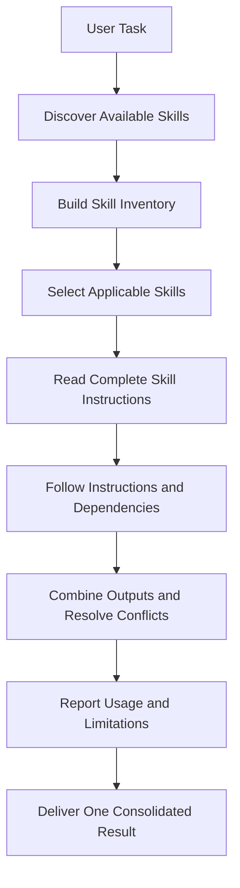

# Claude Skills — All Skills Orchestrator

A skill for discovering, coordinating, and applying the right skills across AI coding-agent workflows.


---

## Overview

**All Skills Orchestrator** is a reusable AI agent skill that coordinates the skills available to an agent during a task. It discovers available skills, identifies which are relevant, reads their complete instructions, follows their dependencies, and combines their contributions into one consolidated result.

The goal is simple: make better use of the skills an AI agent already has access to — without executing irrelevant skills or overlooking important instructions.

Designed for **Claude Code** and adaptable to other skill-compatible AI development environments.

AI coding agents can use specialized skills to perform tasks such as software development, debugging, testing, code review, research, and documentation. As the number of available skills grows, selecting and coordinating the right ones becomes increasingly important.

All Skills Orchestrator provides a structured workflow for this process. Rather than treating every skill as an isolated capability, it evaluates the task as a whole and coordinates the relevant instructions before producing a final result.

---

## Key Features

- **Skill discovery** — Discover the skills available to the current session.
- **Inventory generation** — Build an inventory of available skill names and descriptions.
- **Context-aware selection** — Identify the skills applicable to the user's request.
- **Instruction inspection** — Read the complete `SKILL.md` of every applicable skill before execution.
- **Dependency handling** — Follow the instructions and dependencies defined by selected skills.
- **Conflict resolution** — Combine outputs and resolve conflicting instructions.
- **Execution transparency** — Report which skills were used, skipped, or unavailable.
- **Capability awareness** — Disclose limitations when the available skill inventory is incomplete.
- **Safety-conscious operation** — Require appropriate authorization for destructive operations, deployments, publishing, and actions that could expose secrets.
- **Unified output** — Return one consolidated result that prioritizes the user's actual task.

---

## How It Works

The orchestrator follows a seven-step process.



### Execution Workflow

| Step | Action |
|------|--------|
| **1. Discover** | Identify the skills accessible to the current agent session. |
| **2. Inventory** | Collect their names and descriptions. |
| **3. Select** | Determine which skills are relevant to the requested task. |
| **4. Inspect** | Read the complete instructions for every applicable skill. |
| **5. Apply** | Follow the relevant instructions and dependencies. |
| **6. Consolidate** | Combine the results and resolve conflicts. |
| **7. Report** | Explain which skills were used, skipped, or unavailable, including relevant limitations. |

> The orchestrator does **not** execute unrelated skills simply to increase the number of skills used. Relevance, instruction compliance, and the user's actual objective take priority.

---

## Compatibility

All Skills Orchestrator is designed for skill-based AI agent workflows. It can be adapted to different environments, provided the agent can access the necessary skill instructions and follow the orchestration workflow.

| Environment | Compatibility Approach |
|-------------|------------------------|
| **Claude Code** | Use as a Claude Code skill |
| **Gemini CLI** | Integrate through a compatible skill workflow |
| **OpenAI Codex** | Integrate through its supported skill mechanism |
| **LM Studio** | Use with an agent workflow that can access and apply skill instructions |
| **Bionic** | Use with a compatible skill-enabled configuration |
| **Other AI agents** | Adapt to environments that expose equivalent skill files and discovery capabilities |

> **Compatibility note:** Integration requirements vary between agents and versions. The availability of a `SKILL.md` file alone does not guarantee native support, automatic discovery, or access to every tool. Environments such as LM Studio and Bionic may require an additional agent layer or configuration.

---

## Installation

### 1. Clone the Repository

```bash
git clone https://github.com/0x0806/claude-skills.git
cd claude-skills
```

### 2. Install the Skill in Your Agent

The repository's root `SKILL.md` contains the All Skills Orchestrator definition. Place the skill definition in the directory recognized by your AI agent, using the installation structure required by that platform.

A directory-based skill installation may look like this:

```
all-skills-orchestrator/
└── SKILL.md
```

For **Claude Code**, the skill can be installed in a supported skill directory, such as:

```
your-project/
└── .claude/
    └── skills/
        └── all-skills-orchestrator/
            └── SKILL.md
```

For other agents, follow their respective skill installation and discovery conventions.

### 3. Verify the Installation

Restart or reload the agent session if required. Confirm that the agent can discover the orchestrator and read the instructions of the other skills you want it to coordinate.

---

## Usage

Once the skill is available, request it for tasks that could benefit from multiple specialized skills.

### Feature Development

```text
Use All Skills Orchestrator to implement this feature.

Discover the available skills, identify those relevant to the task,
read their complete instructions, follow their dependencies, and
return one consolidated implementation.
```

### Debugging

```text
Use All Skills Orchestrator to investigate this bug.

Identify and apply the relevant debugging, code-analysis, and testing
skills. Explain the root cause, implement an appropriate fix, and
summarize the validation performed.
```

### Code Review

```text
Use All Skills Orchestrator to review this codebase.

Apply all relevant code-review, security, and testing skills that
are available. Report findings, unresolved issues, and any
limitations in the review.
```

### Documentation

```text
Use All Skills Orchestrator to improve this project's documentation.

Identify relevant documentation and repository-analysis skills,
follow their instructions, and provide a consistent final result.
```

> Invocation syntax and automatic activation depend on the host agent and its configuration.

---

## Design Principles

### Relevance over quantity
Only apply skills that genuinely contribute to the task.

### Instructions before execution
Read the complete instructions of applicable skills before using them.

### Transparency over assumptions
Never claim to have executed a skill unless its instructions were actually applied.

### Honest capability reporting
If the available skill inventory is incomplete, report that limitation instead of claiming exhaustive discovery.

### Safety before action
Do not perform destructive operations, deploy services, publish content, or expose secrets without appropriate authorization.

### One task, one consolidated result
Coordinate the applicable skills and prioritize the user's actual objective.

---

## Limitations

All Skills Orchestrator coordinates existing capabilities; it does not create capabilities that the host environment does not provide.

Its effectiveness depends on:

- The skills accessible to the current session.
- The agent's ability to discover and read skill instructions.
- The tools and permissions available to the agent.
- The dependencies and requirements of individual skills.
- The host platform's support for skill loading and invocation.

It cannot guarantee that every installed skill will be discoverable, that every task can be completed, or that every compatible environment supports identical behavior.

---

## Repository Structure

```
claude-skills/
├── README.md
└── SKILL.md
```

- `SKILL.md` — Contains the orchestrator's instructions.
- `README.md` — Documents its purpose, workflow, compatibility, and usage.

---

## Contributing

Contributions, bug reports, compatibility feedback, and improvements are welcome.

When proposing changes, please preserve the core behavior:

1. Discover and inventory available skills.
2. Select skills based on relevance.
3. Read complete instructions before execution.
4. Follow applicable dependencies.
5. Resolve conflicts and consolidate outputs.
6. Report skill usage and capability limitations honestly.

For significant changes, open an issue to discuss the proposed approach before submitting a pull request.
